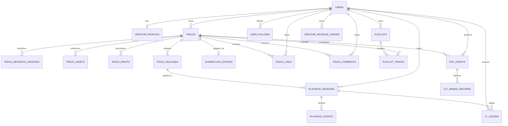

# TimeLink V3 Data Model and Migration Blueprint
**Status:** Target model for implementation planning  
**Version:** 1.0.0  
**Parent:** [MASTER-ARCHITECTURE.md](./MASTER-ARCHITECTURE.md)

This document defines the normalized V3 relational model. It is a target design, not an applied D1 migration. Exact SQL types, legacy-column mappings, and indexes must be validated against the live D1 schema before migration files are authored.

## 1. Modeling rules

- Use opaque text IDs (UUID/ULID generated server-side) for new domain records. Preserve the live D1 identity type: `users.id` is INTEGER, so every new foreign-key column referencing `users.id` (owner, creator, claimant, follower, reporter, moderator, or actor) must also be INTEGER. Never trust client-generated owner IDs.
- Store timestamps in UTC ISO-8601 or integer epoch consistently within a table family; the implementation migration must select one representation and use it consistently. Existing legacy timestamps must be preserved as-is during migration.
- Monetary/accounting amounts use integer units, never floating point.
- Every creator-owned record has an explicit `owner_user_id` and server-enforced ownership checks.
- Soft-delete user content where moderation, financial history, or auditability requires it. Ledger and audit records are append-only.
- Use foreign keys where D1's enforcement and migration strategy permit; also enforce relationships in service transactions.
- JSON is for bounded snapshots/metadata payloads, not canonical many-to-many relationships or financial state.
- Treat MP3 as a creator source Asset, not a free listening product or Release. A creator may retain it locally or explicitly upload it to an approved private storage adapter; D1 stores only provider/object references, never audio bytes or provider credentials. Source Asset availability does not make it publicly streamable.
- Keep `Track`, `Asset`, and `Release` distinct.

## 2. Target entity relationship map

## 3. Table definitions

### 3.1 Identity

#### `creator_profiles`
| Column | Type | Rule |
|---|---|---|
| id | TEXT PK | server-generated |
| user_id | INTEGER FK UNIQUE | references canonical users.id |
| display_name | TEXT | bounded |
| bio | TEXT | bounded |
| avatar_asset_id | TEXT NULL | references track_assets only if generic asset model is extended; otherwise use profile_assets |
| website_url | TEXT NULL | validated URL |
| created_at, updated_at | TEXT | UTC |
| status | TEXT | active/suspended |

Do not create a second credential/account table for creators. Existing user identity remains canonical.

### 3.2 Music catalog

#### `tracks`
| Column | Type | Rule |
|---|---|---|
| id | TEXT PK | stable Track ID |
| owner_user_id | INTEGER FK | creator/owner |
| status | TEXT | draft/active/hidden/under_review/removed |
| visibility | TEXT | private/unlisted/public |
| canonical_metadata_version_id | TEXT NULL | points to confirmed metadata version |
| created_at, updated_at | TEXT | UTC |
| deleted_at | TEXT NULL | soft deletion |

Indexes: `(owner_user_id, updated_at)`, `(status, visibility, updated_at)`.

#### `track_metadata_versions`
| Column | Type | Rule |
|---|---|---|
| id | TEXT PK | |
| track_id | TEXT FK | |
| version | INTEGER | unique per Track |
| original_filename | TEXT | original local filename, not a path |
| extracted_title | TEXT NULL | ID3 extracted value |
| extracted_artist | TEXT NULL | ID3 extracted value |
| extracted_album | TEXT NULL | ID3 extracted value |
| fallback_title | TEXT NULL | filename suggestion |
| verified_title | TEXT NULL | creator-confirmed |
| verified_artist | TEXT NULL | creator-confirmed |
| verified_album | TEXT NULL | creator-confirmed |
| display_title | TEXT | presentation snapshot |
| metadata_source | TEXT | id3/filename_fallback/manual/mixed |
| metadata_status | TEXT | pending_review/confirmed/needs_attention |
| extracted_payload_json | TEXT NULL | bounded allowlisted tags |
| confirmed_by | INTEGER NULL | user ID |
| confirmed_at | TEXT NULL | UTC |
| created_at | TEXT | UTC |

Constraints: unique `(track_id, version)`; never overwrite extraction provenance when creator edits verified fields. Do not store local absolute paths or browser object URLs.

#### `track_assets`
| Column | Type | Rule |
|---|---|---|
| id | TEXT PK | |
| track_id | TEXT FK | |
| asset_type | TEXT | creator_source_reference/cover_art/tl3_release_file/lyrics/sheet_music/other |
| storage_provider | TEXT NULL | provider key, not credentials |
| storage_object_id | TEXT NULL | provider-side object key |
| storage_uri_ref | TEXT NULL | opaque reference resolved server-side |
| content_hash | TEXT NULL | SHA-256 or approved digest |
| size_bytes | INTEGER NULL | non-negative |
| mime_type | TEXT NULL | allowlisted |
| availability_status | TEXT | local_only/available/unavailable/revoked |
| created_by | INTEGER FK | |
| created_at | TEXT | UTC |

Critical invariant: MP3 is a source Asset only, never a free-to-listen Release. `mp3_audio` may be private source material for a Track and is not directly exposed as a public stream. A Track may exist without a source Asset or any Release. The only initial commercial Release type is TL3.

#### `track_rights`
| Column | Type | Rule |
|---|---|---|
| id | TEXT PK | |
| track_id | TEXT FK | |
| claimant_user_id | INTEGER FK | |
| rights_role | TEXT | author/composer/lyricist/performer/producer/label/administrator/other |
| ownership_share_bps | INTEGER NULL | basis points; validate aggregate policy |
| territory | TEXT NULL | ISO country or documented region code |
| valid_from, valid_until | TEXT NULL | UTC/date |
| evidence_ref | TEXT NULL | private evidence reference |
| verification_status | TEXT | declared/pending/verified/disputed/rejected |
| terms_version | TEXT | attestation version |
| attested_at | TEXT NULL | UTC |
| created_at, updated_at | TEXT | UTC |

#### `track_releases`
| Column | Type | Rule |
|---|---|---|
| id | TEXT PK | |
| track_id | TEXT FK | |
| release_type | TEXT | TL3 only in the initial music product |
| version | INTEGER | unique per Track and release type |
| status | TEXT | draft/preparing/ready_for_review/published/suspended/withdrawn |
| asset_id | TEXT FK NULL | published TL3 object asset |
| rights_snapshot_json | TEXT | immutable bounded snapshot at publication |
| price_tl | INTEGER | >= 0; publication policy sets minimum/allowed range |
| duration_seconds | INTEGER NULL | validated positive duration |
| format_version | TEXT NULL | TL3 container version |
| published_at | TEXT NULL | UTC |
| created_at, updated_at | TEXT | UTC |

Constraints: unique `(track_id, release_type, version)`; enforce one active published release per Track/release type unless a future distribution policy defines otherwise.

### 3.3 SharePlace and social

#### `shareplace_entries`
| Column | Type | Rule |
|---|---|---|
| id | TEXT PK | |
| track_id | TEXT FK UNIQUE | one canonical Track placement initially |
| owner_user_id | INTEGER FK | |
| category | TEXT | controlled category |
| visibility | TEXT | private/unlisted/public |
| featured_state | TEXT | normal/featured/limited |
| published_at | TEXT NULL | UTC |
| created_at, updated_at | TEXT | UTC |

Do not use SharePlace entry ID as the Track ID. Discovery placement can change without changing the musical work.

#### `track_likes`
- `id TEXT PK`, `track_id TEXT FK`, `user_id INTEGER FK`, `created_at TEXT`.
- Unique `(track_id, user_id)`; index `(track_id, created_at)`.

#### `track_comments`
- `id TEXT PK`, `track_id TEXT FK`, `user_id INTEGER FK`, `parent_comment_id TEXT NULL`, `body TEXT`, `status TEXT`, `created_at TEXT`, `updated_at TEXT`, `deleted_at TEXT NULL`.
- Index `(track_id, created_at)`; bound body length; prevent arbitrary-depth nesting in the first release.

#### `user_follows`
- `id TEXT PK`, `follower_user_id INTEGER FK`, `following_user_id INTEGER FK`, `created_at TEXT`.
- Unique pair; check follower != following.

#### `playlists`
- `id TEXT PK`, `owner_user_id INTEGER FK`, `title TEXT`, `description TEXT NULL`, `visibility TEXT`, `created_at TEXT`, `updated_at TEXT`, `deleted_at TEXT NULL`.

#### `playlist_tracks`
- `id TEXT PK`, `playlist_id TEXT FK`, `track_id TEXT FK`, `position INTEGER`, `added_at TEXT`.
- Unique `(playlist_id, track_id)`; unique `(playlist_id, position)`.

#### `content_reports`
- `id TEXT PK`, `reporter_user_id INTEGER FK`, `target_type TEXT`, `target_id TEXT`, `reason_code TEXT`, `details TEXT NULL`, `status TEXT`, `moderator_user_id INTEGER NULL`, `resolution_note TEXT NULL`, `created_at TEXT`, `resolved_at TEXT NULL`.
- Index `(status, created_at)`; rate limit per reporter and target.

### 3.4 Playback and financial records

#### `playback_sessions`
- `id TEXT PK`, `user_id INTEGER FK`, `release_id TEXT FK`, `status TEXT`, `license_id TEXT UNIQUE`, `device_binding_hash TEXT NULL`, `started_at TEXT`, `expires_at TEXT`, `last_sequence INTEGER DEFAULT 0`, `validated_seconds INTEGER DEFAULT 0`, `settled_seconds INTEGER DEFAULT 0`, `policy_version TEXT`, `closed_at TEXT NULL`.
- Index `(user_id, status, expires_at)`, `(release_id, started_at)`.
- Never persist raw device fingerprints where a keyed hash suffices.

#### `playback_events`
- `id TEXT PK`, `session_id TEXT FK`, `sequence INTEGER`, `event_type TEXT`, `client_position_ms INTEGER NULL`, `segment_ref TEXT NULL`, `received_at TEXT`, `validation_status TEXT`, `validation_reason TEXT NULL`, `idempotency_key TEXT UNIQUE`.
- Unique `(session_id, sequence)`; never use client-reported duration alone as billable truth.

#### `tl_ledger`
- `id TEXT PK`, `user_id INTEGER FK`, `entry_type TEXT`, `amount_tl INTEGER`, `balance_after_tl INTEGER NULL`, `related_session_id TEXT NULL`, `related_order_id TEXT NULL`, `idempotency_key TEXT UNIQUE`, `description_code TEXT`, `created_at TEXT`.
- Amount is signed or direction+positive amount; choose one convention before SQL and enforce consistently. No UPDATE/DELETE in application paths.
- Index `(user_id, created_at)`.

#### `creator_revenue_ledger`
- `id TEXT PK`, `creator_user_id INTEGER FK`, `track_id TEXT FK`, `release_id TEXT FK`, `playback_session_id TEXT NULL`, `entry_type TEXT`, `amount_tl INTEGER`, `status TEXT`, `idempotency_key TEXT UNIQUE`, `created_at TEXT`.
- Revenue is not identical to listener TL consumption; fees, holds, refunds, and payout adjustments are explicit entries.

#### `poc_events`
- `id TEXT PK`, `user_id INTEGER FK`, `track_id TEXT NULL`, `event_type TEXT`, `source_event_id TEXT`, `score_policy_version TEXT`, `score_value INTEGER`, `validation_status TEXT`, `evidence_ref TEXT NULL`, `idempotency_key TEXT UNIQUE`, `created_at TEXT`.
- Only a successfully completed MP3-to-TL3 conversion may create a deduplicated POC candidate event. MP3 metadata intake and source Asset upload create no POC event. The conversion candidate must be evidence-backed, policy-versioned, and validated before affecting the POC score. It never directly issues TL, TL bonuses, or TLC.

#### `tlc_mining_records`
- `id TEXT PK`, `user_id INTEGER FK`, `poc_batch_id TEXT`, `amount_atomic TEXT`, `chain_id TEXT`, `wallet_address TEXT`, `transaction_hash TEXT NULL`, `status TEXT`, `policy_version TEXT`, `created_at TEXT`, `confirmed_at TEXT NULL`.
- Token amounts use integer atomic units as strings if they exceed safe SQL integer range. Never store private keys or wallet secrets.

## 4. API-to-table ownership

| Service | Canonical tables | Write authority |
|---|---|---|
| Identity | existing users, creator_profiles | Auth/profile service |
| Catalog | tracks, track_metadata_versions, track_assets, track_rights | Track service |
| Release | track_releases, track_assets | Release service |
| Discovery | shareplace_entries | SharePlace service |
| Social | track_likes, track_comments, user_follows, playlists, playlist_tracks, content_reports | Social service |
| Playback | playback_sessions, playback_events | Playback service |
| TL | tl_ledger, creator_revenue_ledger | Economy settlement service only |
| POC/TLC | poc_events, tlc_mining_records | Validated contribution/token services |

A route must not directly mutate another service's tables outside an explicitly shared transaction/service boundary.

## 5. Legacy mapping plan

| Legacy source | V3 target | Migration rule |
|---|---|---|
| `users` | `users` | Preserve existing identity IDs and credential records |
| `tl_shares` | `tracks`, metadata, assets, rights, SharePlace | Candidate mapping only; classify by content type and owner; no blanket one-row-to-one-Track assumption |
| `tl3_releases` | `track_releases`, release asset | Validate referenced share/track, file object, key/format, duration, status, and rights before migration |
| `social_comments` | `track_comments` | Resolve share_id to exactly one V3 Track; unresolved rows remain in legacy source pending manual mapping |
| `user_likes` | `track_likes` | Resolve share_id; deduplicate by user+Track |
| `user_follows` | `user_follows` | Preserve IDs where possible; deduplicate; reject self-follow anomalies into an exception report |
| `playlists` + `share_ids` JSON | `playlists`, `playlist_tracks` | Parse and validate IDs; preserve order; unresolved members are reported, not discarded |
| `playlist_subscribers` | future playlist subscription relation | Do not overload playlist_tracks; add a dedicated table when subscription UX is included |
| `play_logs` | historical analytics staging only | Current observed table had zero rows; do not assume verified billing history |
| `play_events` | legacy analytics staging only | Rows with NULL track_id cannot be attributed to a Track; do not fabricate links |
| legacy POC/TLC records | POC/TLC after validation | Preserve source references and policy version; do not mint retroactively without reconciliation |

## 6. Migration sequence

1. **Schema snapshot:** export D1 schema, indexes, constraints, row counts, and representative non-sensitive records. Do not export credentials or personal secrets into chat/logs.
2. **Preflight:** check table existence, column types, duplicate keys, orphan references, and timestamp formats.
3. **Additive DDL:** create V3 tables and indexes only. No drops, truncations, or destructive alterations.
4. **Backfill rehearsal:** run mapping in a disposable database; produce counts for mapped, skipped, duplicate, and unresolved rows.
5. **Shadow validation:** compare V3 read results to legacy sources; verify ownership and relationship counts.
6. **Dual-read cutover:** enable V3 reads behind a feature flag for a small test group; keep legacy writes/routes operational until verified.
7. **Controlled write transition:** route new V3 writes to V3 tables; define explicit compatibility behavior for legacy pages.
8. **Retirement:** only after separate approval, usage review, backup, and rollback window. Initial V3 delivery does not retire legacy tables.

## 7. Mandatory invariants and test cases

- Track creation stores metadata and source Asset references separately; no standalone MP3 Release or free MP3 publication endpoint exists.
- Source MP3 bytes may be transferred only by a separate creator-authorized Asset upload to an approved storage adapter; verify that no audio bytes are written to D1 or implicitly sent to Workers.
- Original filename, extracted tags, fallback title, and verified title remain independently queryable.
- A Track can exist without a TrackRelease.
- A TL3 Release cannot publish without a valid encrypted release asset, rights snapshot, price, and duration.
- User A cannot read or mutate User B's private Track, release draft, storage connection, or ledger.
- Duplicate registration and social requests are idempotent.
- Likes and follows are unique per pair.
- Playlist order survives insert, move, and deletion.
- Playback event replay cannot double-charge.
- TL ledger reconciliation equals the balance read model.
- POC validation and TLC issuance cannot be triggered by client-side counters. Only a successful TL3 conversion may create a POC candidate; TLC issuance remains a separate policy-controlled process.
- Legacy rows that cannot be safely mapped remain available in legacy tables and are listed in a migration exception report.

## 8. Items to settle before executable SQL

These are implementation details requiring schema inspection, not product questions:
1. Exact current `users` primary key and timestamp conventions.
2. Exact `tl_shares` content-kind and owner fields.
3. Existing foreign-key/index constraints and D1 migration naming conventions.
4. Existing ID format conventions in auth and route handlers.
5. Whether profile artwork needs a generic `user_assets` table rather than reusing Track assets.
6. Whether a single SharePlace entry per Track is sufficient for the first release or multiple placements are needed.

Do not guess these values. Resolve them from a read-only D1 schema snapshot immediately before authoring the first migration.
